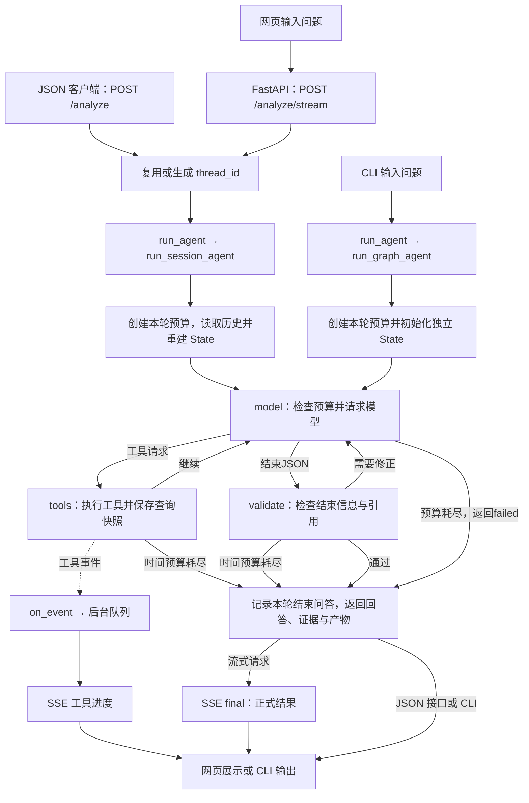
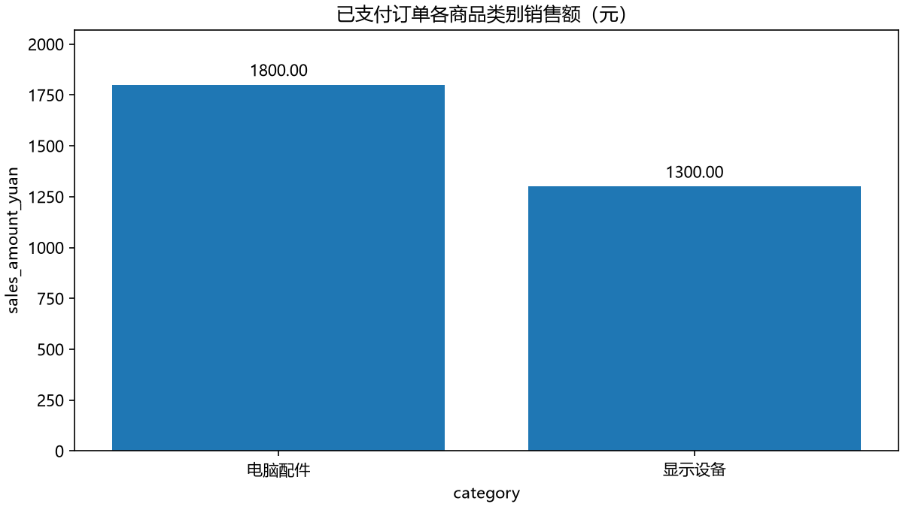
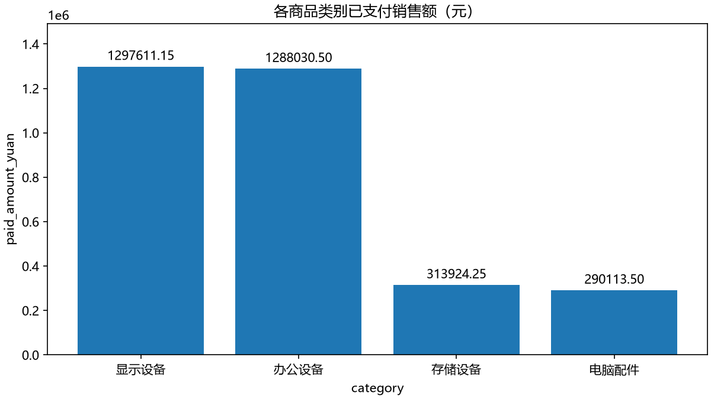

# 业务数据分析 Agent

基于 SQLite、DeepSeek Tool Calling、LangGraph 和 FastAPI 的业务数据分析项目，使用模拟电商数据。
用户用自然语言提出问题，模型选择工具和参数，Python 执行受控查询或绘图，再将结果回传模型生成回答。
网页支持连续追问、缺失条件澄清，通过 SSE 逐条接收工具进度，并在任务结束后展示正式回答和柱状图。

## 版本与验证范围

- 第一版基线：`dbf2804`。下方归档的十题评测结果与耗时对应这一版本。
- 第二版开发中：已加入 Pydantic 统一工具参数校验和任务内查询结果存储。模型向绘图工具传入 query_id，执行层取回对应数据，绘图函数直接使用该结果。
- 已加入任务结束状态与证据检查：区分 completed、needs_clarification、failed；对需要查询的完成结果，检查引用编号是否存在、结果是否被截断。
- 执行流程已迁移为 LangGraph 的 model、tools、validate 三个节点，支持条件路由、任务内查询快照传递与模型调用次数限制。
- LangGraph 迁移已通过离线回归检查和一次真实模型类别销售额绘图验收。
- 网页与 API 已接入 thread_id 和 SQLite checkpointer，支持同编号连续追问、服务重启后恢复历史、新会话隔离，以及澄清后补充条件继续完成任务。
- 会话能力已通过离线检查和真实模型功能验收，详见下方验证记录。
- 已接入可选事件回调、后台任务队列和 POST SSE 接口。网页读取分块事件并更新工具记录，正式回答在结束校验通过后发送。
- SSE 已通过事件、接口及网页离线检查，并完成真实网页验收：工具记录先出现，正式回答随后展示，金额、图片与证据引用一致。
- 分析接口已接入每次分析独立的 `trace_id`、服务端累计耗时与 JSON 追踪摘要，支持响应和日志关联；同会话后续分析仍使用新的追踪编号。
- 追踪功能已通过离线检查，真实 JSON 请求的返回体与结束日志编号、耗时一致。
- 已记录每轮模型请求及每次工具调用的分项耗时，并通过离线检查和一次真实 JSON 请求核验。
- 已保存模型服务返回的逐轮 Token 用量并生成本次任务汇总；用量缺失时标记为未知，已有离线检查和真实 JSON 请求核验记录。
- 已接入每问默认 30 秒的时间预算，在模型、工具和结束校验边界检查；超限时保留已有记录并返回 failed，已完成离线检查和真实正常路径验收。
- 评测报告已记录核心代码清单、运行环境和明确的执行上限；审核时检查实际业务状态是否符合题目预期，已通过离线检查。
- 已准备第二版固定快照（1000 笔订单、12 种商品、2481 条明细）和 20 道开发题，标准答案与参考查询、输入选择和报告记录已通过离线检查。
- 第二版开发集已完成一次真实采集和逐题核验：20/20，平均单题耗时 5.296 秒，模型请求共 75 次；报告、审核依据、日志与图片见下方归档。
- 已准备单独的 20 道保留题（18 道查询、2 道澄清），登记 `v2-test` 入口，并通过离线准备检查；12 个 Agent 核心文件与冻结版本一致，真实保留集成绩待采集。

## 执行链路



- `get_schema`：读取三张业务表的真实建表语句。
- `run_sql`：执行以 SELECT 开头的单条查询，返回列名、数据和截断标记。
- `draw_chart`：根据两列查询结果生成柱状图。

会话模式使用 `SqliteSaver` 将图状态保存到 `sessions.db`。每个新问题只继承已结束问答，轮数、模型调用记录、工具记录、查询缓存、图表和最终结果按本轮重新初始化。

工具使用 SQLite 只读连接、表和函数白名单。查询结果最多预览 100 行，并通过 SQLite 执行进度回调检查约 2 秒的查询预算。
每次任务最多进行 6 轮模型请求；可修复的工具错误会反馈给模型尝试修正。
查询预算是定期检查机制，轮数限制针对模型请求。

## 数据与统计口径

三张表为 `orders`（订单）、`products`（商品）、`order_items`（订单明细）。
一笔订单可以有多条明细，商品通过商品 ID 被不同订单引用。

`seed_data.py` 填充的演示数据包含 6 笔订单、3 种商品、9 条明细，其中已支付 4 笔、已取消 2 笔。网页和普通 CLI 使用业务数据库。
第二版评测从独立 JSON 快照恢复 1000 笔订单、12 种商品、2481 条明细，不改变演示业务库。

- 单价使用整数分：`unit_price_cents`。
- 本项目已支付销售额按 `status = 'paid'` 的明细汇总 `quantity × unit_price_cents`，展示时除以 100 转为元。
- 取消订单的明细金额单独统计。
- 平均每单销售额使用订单数作为分母，关联明细后需要避免重复计数。
- 环比增长以对比月份为基期，例如第一版演示数据中 10 月相对 9 月为 `(1700 - 1400) / 1400 × 100% = 21.43%`。

## 主要文件

| 文件 | 职责 |
| --- | --- |
| [init_db.py](init_db.py)、[seed_data.py](seed_data.py) | 创建业务数据库并插入模拟数据 |
| [tools.py](tools.py) | 数据结构、只读 SQL 和绘图工具 |
| [agent.py](agent.py) | 模型请求与服务用量提取、工具分发、图执行入口与 CLI |
| [graph_agent.py](graph_agent.py) | LangGraph 节点、条件路由、次数与时间预算检查、分项计时和逐轮用量记录 |
| [agent_state.py](agent_state.py) | 任务状态、历史问答初始化、本轮结束记录与用量汇总接入 |
| [usage_models.py](usage_models.py) | 服务 Token 计数的校验、未知值处理与任务汇总 |
| [session_runner.py](session_runner.py) | 按会话编号恢复历史、创建本轮预算、SQLite 持久化与同会话请求冲突保护 |
| [run_budget.py](run_budget.py) | 任务时间上限、剩余时间计算与预算耗尽异常 |
| [event_models.py](event_models.py)、[stream_runner.py](stream_runner.py) | 进度事件外层格式、后台运行与队列生命周期 |
| [run_trace.py](run_trace.py)、[trace_logging.py](trace_logging.py) | 本次分析的追踪编号、累计耗时与 JSON 追踪摘要 |
| [query_store.py](query_store.py) | 查询结果快照的存取与恢复 |
| [main.py](main.py)、[index.html](index.html) | HTTP 接口与网页 |
| [eval_fixture_v1.json](eval_fixture_v1.json)、[eval_cases_v1.json](eval_cases_v1.json) | 第一版固定快照、10 个任务和标准结果 |
| [eval_fixture_v2.json](eval_fixture_v2.json)、[eval_cases_v2_dev.json](eval_cases_v2_dev.json) | 第二版固定快照、20 道开发题及本地标准答案与参考查询 |
| [eval_cases_v2_test.json](eval_cases_v2_test.json)、[check_eval_holdout.py](check_eval_holdout.py) | 20 道保留题、冻结核心指纹、标准答案与澄清审核要点的离线检查 |
| [build_eval_fixture_v2.py](build_eval_fixture_v2.py) | 按固定种子和规则生成第二版快照 |
| [eval_data.py](eval_data.py)、[eval_agent.py](eval_agent.py) | 选择成对输入、校验快照、恢复独立评测库、采集结果与报告元数据 |
| [eval_manifest.py](eval_manifest.py) | 记录评测核心代码、采集与审核脚本、依赖声明的指纹 |
| [summarize_eval.py](summarize_eval.py) | 检查审核记录与预期业务状态，合并结论并生成汇总 |
| [requirements.txt](requirements.txt)、[requirements-dev.txt](requirements-dev.txt)、[.env.example](.env.example) | 运行依赖、开发检查依赖与配置模板 |

## 本地启动

已验收环境：Windows、Python 3.12.0、SQLite 3.42.0。
绘图使用 Microsoft YaHei 中文字体。第三方库版本见 `requirements.txt`。

在项目根目录使用 PowerShell。虚拟环境通过 Python 内置的 [venv](https://docs.python.org/3.12/library/venv.html) 创建：

```powershell
if (-not (Test-Path -LiteralPath .\venv\Scripts\python.exe)) {
    python -m venv venv
}
.\venv\Scripts\python.exe -m pip install -r .\requirements.txt

if (-not (Test-Path -LiteralPath .\.env)) {
    Copy-Item -LiteralPath .\.env.example -Destination .\.env
}
```

打开 `.env`，将占位文本替换为自己的 DeepSeek API Key：

```dotenv
DEEPSEEK_API_KEY=your_api_key_here
```

模型名由 `agent.py` 中的 `MODEL_NAME` 配置，当前为 `deepseek-flash`。
配置模板可提交到仓库，真实 `.env` 由 `.gitignore` 排除。

创建并填充业务数据库：

```powershell
.\venv\Scripts\python.exe -X utf8 init_db.py
.\venv\Scripts\python.exe -X utf8 seed_data.py
```

种子脚本按主键跳过已有记录；新的空数据库运行后得到上述模拟数据。

通过 [Uvicorn](https://fastapi.tiangolo.com/deployment/manually/) 启动本地开发服务：

```powershell
.\venv\Scripts\python.exe -m uvicorn main:app --host 127.0.0.1 --port 8001 --reload
```

- 网页：[http://127.0.0.1:8001/](http://127.0.0.1:8001/)
- 接口调试：[http://127.0.0.1:8001/docs](http://127.0.0.1:8001/docs)

也可以使用 CLI：

```powershell
.\venv\Scripts\python.exe -X utf8 agent.py
```

CLI 当前执行单次独立任务；网页与 API 通过 `thread_id` 支持连续会话。

示例问题：

- 已支付订单共有多少笔？
- 2026 年 10 月的已支付销售额相比 9 月增长了百分之多少？
- 按商品类别统计已支付销售额，降序排列并绘制柱状图。

## 演示效果

示例问题：按商品类别统计已支付订单的销售额，按销售额降序排列，并绘制柱状图。

下图来自 2026-11-14 的固定任务评测：电脑配件销售额为 1800 元，显示设备为 1300 元。



## 接口

`POST /analyze` 接收 JSON，`question` 必填，`thread_id` 可选。
下例用自定义编号开始一个会话：

```json
{"question": "2026年9月的已支付销售额是多少元？", "thread_id": "demo-A"}
```

继续追问时沿用同一编号：

```json
{"question": "那10月份呢？", "thread_id": "demo-A"}
```

不传 `thread_id` 或传 `null` 时，API 会生成新编号；响应返回本次实际使用的 `thread_id`，后续追问需要传回该编号。
编号去除首尾空格后须为 1—128 个字符。请求拒绝错误类型及多余字段。

响应包含 `thread_id`（会话编号）、`status`（任务状态）、`answer`（回答）、`evidence_query_ids`（引用查询编号）、`model_calls`（模型调用及用量记录）、`usage_summary`（本次用量汇总）、`steps`（工具调用及反馈）、`charts`（图表），以及接口附加的 `trace_id`、`elapsed_ms`。
`completed` 表示结束信息与引用检查通过，业务答案仍需核验；`needs_clarification` 表示需要补充条件；`failed` 表示本轮未能完成。
HTTP 200 与业务完成状态分别判断。

对于 `/analyze`，同一服务进程中同编号的重叠请求返回 HTTP 409；模型请求超时返回 504，模型服务请求失败返回 502。
HTTP 接口将图表路径转换成图片 URL，CLI 和评测记录保存磁盘路径。
图片由 `GET /outputs/文件名.png` 读取已有文件。

### 流式接口

`POST /analyze/stream` 使用相同的 JSON 请求字段，响应类型为 `text/event-stream`。
当前网页通过 `fetch` 发送 POST，并持续读取响应体；`/analyze` 继续保留完整 JSON 返回方式。

| 事件 | 内容与含义 |
| --- | --- |
| `tool_start` | 即将执行工具调用，包含轮数、工具调用编号、工具名与原始参数 |
| `tool_result` | 工具执行结果，包含对应步骤、`result` 与该次调用的 `duration_ms`；`ok=false` 时模型仍可修正后继续 |
| `final` | 整次调用取得正式结果，包含原接口结果字段和图表 URL；任务状态可以是完成、澄清或失败 |
| `error` | 本次执行无法继续，包含会话编号、错误类型、说明及对应的 `status_code` |

进度由 Python 在工具派发与反馈时产生，预算拦截的步骤会明确标记跳过。未经结束校验的模型文案不会作为 `final` 发送。
事件回调与发送队列是运行时对象，不放入 State 或 SQLite 检查点。

请求字段错误在推送开始前返回 HTTP 400／422；推送开始后 HTTP 响应已经发出，执行异常改用 `error` 事件传递。
例如，同会话冲突、模型超时分别在 `error.data.status_code` 中表示为 409、504，不能只看 HTTP 200 判断任务是否成功。

后台队列有长度上限，客户端断开后停止积压发送事件。正在执行的模型请求不会被强行终止，原任务会自行收尾；同会话占用在实际任务结束后释放。
网页收到正式终止事件后停止读取；连接提前结束而没有 `final` 时显示故障，保留已收进度和输入，不自动重发任务。
本地问答历史的恢复使用 `thread_id`；当前未实现 SSE 的事件重放或 `Last-Event-ID` 断点续传。

### 分析追踪与耗时

请求通过问题与会话编号校验后，由 Python 为本次分析创建 `RunTrace`：

| 字段 | 用途 |
| --- | --- |
| `thread_id` | 选择会话历史；同会话的追问沿用 |
| `trace_id` | 区分本次分析；每次请求重新生成 |
| `elapsed_ms` | 本次服务端分析的累计耗时，单位毫秒 |
| `X-Trace-ID` | HTTP 响应头中的追踪编号 |

`POST /analyze` 在成功响应体中附加追踪编号与耗时；发生执行异常时，通过响应头的追踪编号查找错误摘要，保留原来的 `detail` 字符串和错误码。
`POST /analyze/stream` 的工具事件、`final`、`error` 数据中附加相同追踪编号和累计耗时；响应头的 `X-Trace-ID` 与之对应。
追踪字段由程序生成，不能在请求体中指定，也不要求模型在业务结束 JSON 中生成这些字段。

计时使用 `perf_counter`，从创建本次追踪对象到 Agent 返回或发生执行异常时结算。`finish()` 后耗时固定，结果和结束日志使用同一份数值。
它包含本次调用中的模型请求、工具执行及会话保存等时间，不是单条 SQL 耗时或 CPU 时间，也不代表客户端到服务端的完整网络往返与浏览器渲染耗时。
客户端断开只停止事件发送；后台实际结束后才结算并记录结束摘要。
校验失败的 400／422 尚未启动分析，不分配本次分析的追踪编号。直接调用 `run_agent()` 也会返回模型与工具分项记录；`trace_id` 和累计 `elapsed_ms` 由 HTTP 接口层附加。

新增追踪摘要复用 Uvicorn 日志配置，消息内容为 JSON：

- JSON 接口记录 `analysis_start`、`analysis_end` 或 `analysis_error`。
- SSE 接口还记录工具的 `tool_start`、`tool_result` 摘要。
- 摘要包含追踪与会话编号、耗时、状态、工具调用标识或错误类型，不加入问题、SQL 参数、结果行或回答。原有模型和工具调试打印仍保留。
- 追踪对象和计时函数不放进会话 State 或 SQLite 检查点；同一会话的下一问重新计时。

### 模型与工具分项耗时

| 字段 | 记录范围 |
| --- | --- |
| `model_calls[].round`、`model_calls[].duration_ms` | 每次正常返回的 `request_model()` 调用，包含模型服务等待、网络请求与响应解析 |
| `steps[].duration_ms` | 本次 `call_tool()` 执行，包含参数处理、工具执行及结果保存等；不是纯 SQLite 引擎计算时间 |
| `elapsed_ms` | 整次服务端分析，除上述调用外，还包含图调度、结束校验、调试输出与会话保存等开销 |

分项使用 `perf_counter()` 前后相减，转换为毫秒并保留三位小数。工具进度回调和后续打印不计入该工具的执行耗时。
工具返回 `ok=false` 仍记录耗时；模型已返回但结束格式不合格时，该次耗时也会保留，后续修正请求另记一轮。
模型请求预算在调用前检查，达到上限时不额外生成模型调用记录。未处理的执行异常继续交给接口错误流程。
分项记录只保存轮次、数值等可序列化数据，不保存计时器；同一会话开始新问题时清空本轮记录，只继承已结束问答。
模型业务结束 JSON 仍只有原来的三个字段，性能记录由程序附加。JSON 响应与 SSE `final` 均包含 `model_calls` 和完整 `steps`；工具 `tool_result` 事件携带对应步骤的耗时。
当前网页维持工具状态与回答展示，新增 JSON 追踪日志摘要仍按上一节字段记录。


### Token 用量

模型请求函数保留 HTTP 响应顶层的 `usage`，图节点提取三种基础计数写入 `model_calls[].usage`：`prompt_tokens`（输入）、`completion_tokens`（输出）、`total_tokens`（两者之和）。字段定义见 [DeepSeek Chat Completions 官方文档](https://api-docs.deepseek.com/zh-cn/api/create-chat-completion/)。
计数使用服务实际返回值，包含每次请求所带入的上下文；不按问题字数估计，也不将缓存命中数再次叠加到输入总数。

`TokenUsage` 严格检查非负整数以及输入加输出等于总数；服务附带的缓存等扩展字段暂时忽略。缺失或 `null` 用量保留为 `None`（JSON 中为 `null`），明确返回的零计数则保留为 0。格式不合法的计数触发校验错误，沿既有执行异常流程处理。

任务结束时，Python 根据本轮已保存的调用记录计算 `usage_summary`：

| 字段 | 含义 |
| --- | --- |
| `model_call_count` | 本轮已记录的模型调用数量 |
| `usage_call_count` | 其中提供有效用量的调用数量 |
| `complete` | 上述数量是否相等，表示用量覆盖是否齐全 |
| `prompt_tokens`、`completion_tokens`、`total_tokens` | 所有记录用量齐全时逐轮相加，否则三个总计均为 `null` |

`complete` 与业务 `status` 分别判断：业务分析可以完成而用量不齐全，任务失败也可能具有完整的用量记录。没有调用记录时，两种调用数量和三个总计均为 0。
格式纠错产生的已返回调用也计入；同一会话的新问题重建本轮记录，不累计上一问的用量。后续请求再次发送的历史上下文仍属于该次请求的输入。

逐轮用量与汇总由程序附加到正式结果，JSON 响应和 SSE `final` 均可携带。模型消息、工具反馈和已结束问答历史不混入这些统计字段；原有模型结束 JSON 继续只有三个业务字段。
当前统计基础 Token 数量，尚未计算货币费用或设置全任务 Token 上限。网页与 JSON 追踪摘要的展示字段维持原有范围。

### 任务时间预算

CLI、独立图调用和会话调用均默认使用 `max_seconds=30.0`。每次分析只创建一个 `TaskBudget` 并交给图运行时使用；同一会话的下一问重新创建，不继承上一问的剩余时间。
具体入口校验参数后开始计时，会话模式将路径准备、历史恢复和 State 重建也计入。预算对象与计时起点不写入 State 或 SQLite 检查点。

当前几种限制分别作用于不同范围：

| 限制 | 默认值 | 范围 |
| --- | --- | --- |
| 模型请求次数 `max_rounds` | 6 轮 | 本次分析的模型调用次数 |
| SQL 执行预算 | 约 2 秒 | 单条查询，由 SQLite 进度回调定期检查 |
| HTTP `timeout` | 连接 10 秒、读取等待 60 秒 | 单次模型服务通信的等待，见 [Requests 超时说明](https://requests.readthedocs.io/en/latest/user/quickstart/#timeouts) |
| 任务时间预算 `max_seconds` | 30 秒 | 在模型请求、每个工具和结束校验的执行边界检查 |

Python 调用可以指定本次时间上限，例如 `run_agent(question, max_seconds=10)`；HTTP 请求体仍只接受原来的 `question` 和 `thread_id`，不开放客户端改写该上限。

- 请求前检查剩余时间；请求返回后先保留真实用量与耗时，再检查是否已超限。
- 同轮多个工具分别检查。已经完成的结果、查询快照、图表和步骤保留，尚未派发的工具停止运行。
- 若发送 `tool_start` 后预算耗尽，实际工具不会执行，程序返回明确的预算错误反馈，并标记 `skipped: true`、`duration_ms: 0.0`，表示该调用被跳过。
- 结束校验前后也检查时间，工具节点已经生成最终失败结果时直接到 `END`，本轮问答只保存一次。
- 预算耗尽作为业务 `failed` 返回：JSON 接口仍可为 HTTP 200，SSE 使用 `final`。通信异常继续沿原来的 HTTP 错误／SSE `error` 流程处理。

这是执行边界的时间控制。正在运行的同步请求不会被强行中断，仍受原有网络／SQL 超时约束；任务会在下一个检查点发现超限并停止后续处理，实际返回时间可能超过设定值。
预算已过但请求尚未返回时，会话继续保持占用，直到实际结束才释放。当前未设置全任务 Token 硬上限。

## 会话行为

- 网页自动保存并传递会话编号，“新会话”生成新编号。
- 浏览器 `sessionStorage` 只保存编号；同一标签页刷新后可继续当前会话。页面暂时只显示本次打开后的问答，没有历史会话列表。
- 后端通过同一 `thread_id` 读取 SQLite 中的历史。服务重启后，使用原编号可以继续会话；换编号会读取另一个会话。
- 记录已结束的用户问题与最终回答，包括澄清和失败说明；临时无效回答与纠错反馈不作为后续问答历史。
- 历史用于理解省略与指代；统计值在本轮重新查询，上一轮的 `query_id` 不能直接用于本轮取数、绘图或结束引用。
- 缺少指代范围时提示模型先澄清；用户补充月份后，结合本会话原请求继续分析。该规则通过模型指令引导，结束校验仍负责格式、编号归属与截断检查，业务语义需要核验。
- 同会话请求冲突保护限于单个服务进程，尚未实现多 worker 间的请求协调。

`sessions.db` 与其伴随文件由 `.gitignore` 排除。评测和默认 CLI 调用不传 `thread_id`，每题保持独立任务，不读取业务会话历史。

## 会话功能验证

下面命令用于在新环境复现离线检查。检查使用预设模型响应，持久化检查使用临时数据库，不调用真实模型：

```powershell
.\venv\Scripts\python.exe -m pip install -r .\requirements-dev.txt
.\venv\Scripts\python.exe -X utf8 check_turn_history.py
.\venv\Scripts\python.exe -X utf8 check_session_memory.py
.\venv\Scripts\python.exe -X utf8 check_session_api.py
node .\check_session_page.cjs
```

最后一项需要 Node.js，使用内置模块执行网页脚本的逻辑检查；运行 Python 后端不需要 Node.js。
离线检查覆盖历史传递、两个独立进程恢复同会话、不同编号隔离、异常后的历史保留、同编号请求冲突、无编号独立调用，以及网页编号与状态显示。
网页逻辑检查使用模拟 DOM 和分块字节流，不代替真实浏览器验收。

2026-11-17，已在真实网页和模型上完成以下功能验收：

| 场景 | 本次观察结果 |
| --- | --- |
| 连续追问 | 先问九月已支付销售额，再问“那十月份呢”；分别重新查询得到 1400 元、1700 元 |
| 服务重启恢复 | 使用原会话编号，恢复九月、十月历史；本轮限定这两个月重新查询，合计 3100 元 |
| 新会话隔离与澄清 | 新编号没有旧月份信息，返回 needs_clarification，没有查询销售额或猜测月份 |
| 补充条件继续完成 | 同一会话补充“2026年9月和10月。”后，恢复原统计要求并重新查询，返回 completed 和本轮证据编号 |

上述记录用于验证会话行为；第一版十题与第二版开发集的批次结果分别归档在下方。

## SSE 功能验证

在已有开发依赖环境中，可用下面命令复现离线检查；它们使用预设模型与工具，不调用真实模型 API：

```powershell
.\venv\Scripts\python.exe -X utf8 check_agent_events.py
.\venv\Scripts\python.exe -X utf8 check_agent_completion.py
.\venv\Scripts\python.exe -X utf8 check_sse_api.py
.\venv\Scripts\python.exe -X utf8 check_session_api.py
node .\check_session_page.cjs
```

检查覆盖事件与真实工具调用的先后顺序、失败后继续修复、事件数据隔离、旧接口兼容、任务尚未结束时收到进度、有界队列与客户端断线清理、同会话占用、终止事件、SSE 响应头及帧格式，以及网页中文分块解析与异常处理。
队列和断线场景使用临时数据库、假模型或 ASGI 消息模拟；所有测试线程在结束时收尾。

2026-11-17，真实网页请求“按商品类别统计已支付订单的销售额，按销售额降序排列，并绘制柱状图。”的核验记录：

| 检查项 | 本次结果 |
| --- | --- |
| 统计结果 | 电脑配件 1800 元、显示设备 1300 元，均来自本轮已支付订单查询 |
| 查询与绘图关联 | 绘图参数、工具反馈与最终引用使用同一 `query_id` |
| 图片 | 两柱降序、中文和金额正常，用户确认网页显示正常 |
| 结束校验 | 第 4 轮夹带文案的结束信息被拒绝，第 5 轮修正后才正式返回；历史仅保存通过后的回答 |
| 回答前的进度显示 | 用户确认先看到工具记录，随后才出现正式回答 |

本次为功能验收记录，不替代第二版完整业务题集评测。

## 追踪功能验证

使用以下命令复现离线检查，不调用真实模型 API：

```powershell
.\venv\Scripts\python.exe -X utf8 check_trace_api.py
.\venv\Scripts\python.exe -X utf8 check_session_api.py
.\venv\Scripts\python.exe -X utf8 check_sse_api.py
```

新检查使用可控时钟验证单位换算、结束后耗时固定、同会话不同分析编号、响应头／事件／日志关联，以及断开连接后后台完成的计时边界。
检查里的 50／125／150 毫秒是预设值；异常用例产生的 `analysis_error` 是测试内容。

2026-11-17，真实 `POST /analyze` 请求“已支付订单共有多少笔？”的核验记录：

| 检查项 | 本次结果 |
| --- | --- |
| 业务结果 | `completed`，已支付订单 4 笔，查询与最终证据编号一致 |
| 返回体与日志 | 同一 `trace_700950514bc74dac8e29b45a67501dd9` 对应本次开始、结束与返回结果 |
| 累计耗时 | 返回体与 `analysis_end` 均为 6206.983 毫秒，约 6.207 秒 |
| 真实响应头 | 用户确认 `x-trace-id` 与返回体、追踪日志编号一致 |

上述耗时仅是一次真实请求的样例，不是平均响应时间或独立评测指标。
SSE 追踪元数据、异常及断线边界由离线检查覆盖；本次真实样例使用 JSON 接口。
任务时间预算的实现与验证见下文。

## 模型与工具耗时验证

在已有开发依赖环境中，执行以下离线检查：

```powershell
.\venv\Scripts\python.exe -X utf8 check_model_timing.py
.\venv\Scripts\python.exe -X utf8 check_tool_timing.py
.\venv\Scripts\python.exe -X utf8 check_agent_events.py
```

检查通过可控时钟确认模型与工具各自计时、进度回调等待被排除、失败工具仍有耗时、结束格式纠错保留全部实际调用、预算耗尽不虚增记录、新问题重置，以及事件数据隔离和 SQLite 检查点兼容。
检查中的 25／75、100／250 毫秒是预设值，不是服务性能测量。

2026-11-17，另一条真实 `POST /analyze` 请求“已支付订单共有多少笔？”的核验记录：

- 会话编号：`timing-check-A`；追踪编号：`trace_4beb9a9574a248a7b819fa836a72d202`。
- 返回 `completed`，已支付订单 4 笔；SQL 查询结果为 `[[4]]`、未截断，最终引用与本轮查询编号一致。
- 本次共 3 次模型请求、2 次工具调用，耗时如下。

| 项目 | 本次耗时（毫秒） |
| --- | ---: |
| 第 1 次模型请求 | 832.167 |
| 第 2 次模型请求 | 1322.378 |
| 第 3 次模型请求 | 982.458 |
| `get_schema` | 0.478 |
| `run_sql` | 0.611 |
| 其余开销（总耗时减去分项之和） | 31.442 |
| 服务端分析总耗时 | 3169.534 |

本次模型调用合计 3137.003 毫秒，占总耗时约 98.97%；工具合计 1.089 毫秒。
模型分项包含网络和服务等待，不能据此单独拆出推理时间或网络时间；其余开销为差值，没有进一步测量各项占比。
上述数据仅对应本次真实请求，不是平均响应时间或版本性能对比；第二版开发集结果见下方归档。

## Token 用量验证

在已有开发依赖环境中执行以下检查。它们使用预设数据、HTTP 响应或工具，不调用真实模型；请求适配检查会替换环境读取函数，不读取真实 API Key：

```powershell
.\venv\Scripts\python.exe -X utf8 usage_models.py
.\venv\Scripts\python.exe -X utf8 check_model_usage.py
.\venv\Scripts\python.exe -X utf8 check_usage_summary.py
.\venv\Scripts\python.exe -X utf8 check_agent_events.py
.\venv\Scripts\python.exe -X utf8 check_agent_completion.py
```

检查覆盖格式与总数校验、未知值和明确零值、服务响应提取、记录隔离、纠错调用的保留、预算耗尽不虚增调用、完整与缺失用量的汇总，以及正式结果和 SQLite 检查点保存。
335／575 个 Token 等数字为检查中的预设值。

2026-11-17，真实 `POST /analyze` 请求“已支付订单共有多少笔？”的核验记录如下。追踪编号为 `trace_067e4db142e5491ab65b9c24a679f45b`；业务状态为 `completed`，SQL 返回 4 笔已支付订单、结果未截断，最终证据与本轮查询编号一致。

| 模型调用轮次 | 输入 Token | 输出 Token | 总 Token |
| --- | ---: | ---: | ---: |
| 1 | 1068 | 26 | 1094 |
| 2 | 1295 | 68 | 1363 |
| 3 | 1429 | 64 | 1493 |
| 4 | 1561 | 56 | 1617 |
| 合计 | 5353 | 214 | 5567 |

`usage_summary` 的 `model_call_count=4`、`usage_call_count=4`、`complete=true`；三个汇总计数与逐轮相加一致。
本次服务端总耗时为 3825.884 毫秒。
这是一条真实 JSON 请求的功能验收记录，不代表平均用量、费用或完整业务题集评测结果。

## 时间预算验证

在已有开发依赖环境中执行以下检查，不请求真实模型 API：

```powershell
.\venv\Scripts\python.exe -X utf8 run_budget.py
.\venv\Scripts\python.exe -X utf8 check_graph_budget.py
.\venv\Scripts\python.exe -X utf8 check_entry_budget.py
.\venv\Scripts\python.exe -X utf8 check_session_memory.py
```

检查使用可控时钟、预设模型与工具。会话检查使用临时 SQLite，HTTP 检查使用本地 TestClient，跨进程检查会在新 Python 进程中恢复同一临时会话。
覆盖调用前已耗尽、模型返回后超限仍保存用量、同轮工具停止与已完成结果保留、进度发送期间耗尽、校验前后过期、同会话新问题预算重置、错误参数拒绝、异常清理，以及 JSON／SSE 的预算失败终态。
预算边界用例中的 2 秒／30 秒由可控时钟推进，不需要实际等待这些时长。

2026-11-18，默认 30 秒预算下，真实 `POST /analyze` 请求“已支付订单共有多少笔？”的正常路径核验记录：

| 检查项 | 本次结果 |
| --- | --- |
| 会话编号 | `budget-check-A` |
| 业务结果 | `completed`，已支付 4 笔、已取消 2 笔，均有本轮分组查询依据 |
| 执行记录 | 3 次模型请求、2 次成功工具调用，查询未截断、最终引用与查询编号一致 |
| 服务端总耗时 | 6934.094 毫秒，约 6.934 秒 |
| Token 汇总 | 输入 3814、输出 155、合计 3969，逐轮求和一致；用量覆盖 3/3 |
| 追踪编号 | `trace_4b762ef5bb734eb2a1efc577190ab57b` |

该真实样例验证预算内的正常返回，超限分支由上述离线检查覆盖。单次耗时不代表平均性能，第二版开发集结果见下方归档。

## 固定任务评测

评测按 `--suite` 选择成对的数据快照与题集，并恢复独立数据库，避免业务库后续新增订单改变评测数据。
每题独立调用 Agent，不传会话编号。脚本只传入问题与明确的执行上限，标准结果 `expected`、预期业务状态 `expected_status` 和参考 SQL 留在本地用于核对。

| `--suite` | 数据文件 | 题目文件 | 规模与用途 |
| --- | --- | --- | --- |
| `v1`（默认） | [eval_fixture_v1.json](eval_fixture_v1.json) | [eval_cases_v1.json](eval_cases_v1.json) | 6 笔订单、3 种商品、9 条明细、10 题，`split=legacy` |
| `v2-dev` | [eval_fixture_v2.json](eval_fixture_v2.json) | [eval_cases_v2_dev.json](eval_cases_v2_dev.json) | 1000 笔订单、12 种商品、2481 条明细、20 道开发题，`split=development` |
| `v2-test` | [eval_fixture_v2.json](eval_fixture_v2.json) | [eval_cases_v2_test.json](eval_cases_v2_test.json) | 同一第二版快照、20 道保留题，`split=holdout` |

第二版数据由 `build_eval_fixture_v2.py` 使用固定种子 `20261118` 生成，覆盖 2026 年 1—6 月、4 个地区和 4 类商品，含 800 笔已支付订单与 200 笔取消订单。
数据保留了同商品不同成交价、零金额明细、未售出商品、月份边界和无订单月份。
固定种子、生成规则和运行环境一致时可重复生成同一数据；生成器复用第一版表结构，以 `x` 模式保存新文件，拒绝覆盖已有快照。仓库已提供两份快照，直接检查即可。

20 道开发题覆盖订单数、金额与件数、月份／地区／商品／类别分组、日期范围、客单价、空结果、成交价与单位换算、环比和柱状图。
标准答案从快照按整数分与 Decimal 计算，再与 SQLite 参考查询核对；`check_eval_cases_v2.py` 用内存数据库重查标准结果。参考查询也已通过现有只读工具的限制。
开发集用于调试，已完成一次真实模型采集和逐题核验，结果见下方“第二版开发集结果”；之后的保留题集单独验收和记录。

第二版数据指纹前 16 位为 `f38dfff16bf45ab7`，开发题集为 `dc761013f17a2113`。
第一版快照仍可由 `freeze_eval_data.py` 从业务库制作，已归档文件继续保留。

新采集报告使用 `report_version: 2`，记录以下信息：

| 信息 | 报告内容 |
| --- | --- |
| 固定输入 | `suite_name`、`split`、两个输入文件名、数据与题集版本，以及各自的 SHA-256 指纹 |
| 代码清单 | `code_manifest` 保存 18 个声明文件的逐文件指纹和总指纹，包含核心执行代码、评测与审核脚本、依赖声明；完整清单见 [eval_manifest.py](eval_manifest.py) |
| 环境 | Python、SQLite、操作系统信息，以及当前环境实际安装的包名与版本 |
| 执行上限 | 显式传入并记录 `max_rounds: 6`、`max_seconds: 30.0`；时间预算仍按前文所述在执行边界检查 |
| 每题记录 | 本地标准结果、预期状态、函数执行状态、Agent 返回结果、耗时与日志文件名；返回结果保留逐轮模型用量和工具记录 |

代码指纹按 UTF-8 文本计算，统一 BOM 和换行；修改代码文本或依赖声明会改变指纹，必需文件缺失时直接报错。
原有 `agent_code_sha256`、`tools_code_sha256` 字段继续保留。
报告结构版本为 2，代码清单格式版本为 1；数据与题集版本由所选输入决定，`v1` 为 1，`v2-dev` 与 `v2-test` 为 2。

第二版准备检查及离线复现命令如下：

```powershell
.\venv\Scripts\python.exe -X utf8 eval_agent.py --suite v2-dev --case all --check-only
.\venv\Scripts\python.exe -X utf8 check_eval_fixture_v2.py
.\venv\Scripts\python.exe -X utf8 check_eval_cases_v2.py
.\venv\Scripts\python.exe -X utf8 check_eval_suite_entry.py
.\venv\Scripts\python.exe -X utf8 check_eval_manifest.py
.\venv\Scripts\python.exe -X utf8 check_eval_report_metadata.py
.\venv\Scripts\python.exe -X utf8 check_eval_review.py
```

`--check-only` 在内存数据库中检查快照能否恢复，并检查报告信息；不启动 Agent，也不创建评测批次目录。
检查脚本使用内存／临时数据库、临时文件或预设 Agent，不请求真实模型服务。
覆盖固定生成、标准答案、v1／v2 选择与旧默认兼容、错误输入拒绝、报告记录、采集隔离和审核规则。
检查通过说明评测流程按约定工作，通过率需要完成真实采集和人工审核后统计。

不传 `--suite` 时仍使用 `v1`。不指定 `--case` 时选择当前题集首题：`v1` 为 `E01`，`v2-dev` 为 `D01`，`v2-test` 为 `T01`；`--case all` 表示所选题集的全部题目。
第一版准备检查仍可使用原命令 `eval_agent.py --case all --check-only`。

第二版单题试跑与完整采集命令如下，两条都会调用模型服务：

```powershell
.\venv\Scripts\python.exe -X utf8 eval_agent.py --suite v2-dev --case D01
.\venv\Scripts\python.exe -X utf8 eval_agent.py --suite v2-dev --case all
```

每批结果保存在新建的 `eval_runs/run_*/` 目录，包括独立数据库、原始报告、逐题日志和生成的图片。
第一版全题采集仍可使用原命令 `eval_agent.py --case all`。

### 保留题集准备与验收

保留题集 T01—T20 使用同一第二版固定快照，加入季度组合筛选、销量／日期／订单排行、订单级聚合、加权成交价、占比、双维分组、空订单与零基期等场景，以及 2 道缺失条件澄清题。
它与开发集分别保存，没有重复题号或相同题目文本，衡量的是同一模拟数据上的新问题表现。

`eval_cases_v2_test.json` 的 `frozen_source_revision=a1bc477`，`frozen_runtime_files` 保存冻结时 12 个核心文件的文本指纹，涵盖模型请求、提示词、图流程、工具、参数与结束校验、查询存储、预算、用量和会话等模块。
`check_eval_holdout.py` 检查这些指纹、固定快照与题集绑定、18 条参考只读查询、2 道澄清题的审核条件，以及开发／保留题的区分。
评测入口 `eval_data.py` 的题集登记属于采集配置，不在这 12 个核心文件中；新增登记会改变报告的代码总指纹，核心文件仍应与冻结清单一致。
保留题集指纹前 16 位为 `dfb849382da2e648`。

准备检查不调用模型：

```powershell
.\venv\Scripts\python.exe -X utf8 check_eval_holdout.py
.\venv\Scripts\python.exe -X utf8 eval_agent.py --suite v2-test --case all --check-only
```

- 18 道查询题的预期状态为 `completed`，需要核对 SQL 结果、最终答案、当前查询证据，以及 T14 的订单笔数柱状图。
- T16 应询问年份和月份，T20 应询问地区，两题的预期状态均为 `needs_clarification`。需要核对实际询问内容，不能只凭状态字段判通过。
- T15 查询不存在的订单，应说明没有找到，不能当作已有的零金额订单；T18 基期金额为零，应说明无法按该公式计算增长率，不能回答为 0%、100% 或无穷大。
- 标准答案、参考 SQL 与 `review_points` 留在本地用于审核，不传给 Agent；各题独立执行，不读取业务会话历史。

固定题目和源码版本后，使用下列命令采集完整保留集。此命令会调用真实模型 API：

```powershell
.\venv\Scripts\python.exe -X utf8 eval_agent.py --suite v2-test --case all
```

保留集成绩按预先定义的状态和审核要点逐题核验，与开发集结果分开记录。目前只完成准备检查，尚无真实保留集成绩。
保留首轮运行记录；如果后续依据这些题修改提示词或核心逻辑，应说明这批题已参与调试，并另备新的验收题。

### 审核与汇总新批次

1. 确认原始报告的 `suite_name`、`split` 与本次题集一致；对照每题的 `expected`，核对成功 SQL 结果、最终回答、统计口径和要求的图片。
2. 在该批次目录创建 `review.json`，格式可参考[已归档审核记录](eval_runs/run_0d6a458fdeda/review.json)。
3. 为该批次每个题目填写真实的 `passed` 布尔值与非空 `notes`。`execution_status=completed` 只表示函数正常返回；`result.status` 才是 Agent 的业务状态。
4. 新报告中，标记通过必须满足函数正常返回、实际业务状态等于 `expected_status`。`v1` 的 10 题默认预期 `completed`，`v2-dev` 的 20 题显式要求 `completed`；`v2-test` 则有 18 题要求 `completed`、2 题要求 `needs_clarification`。状态匹配后仍需核对答案、SQL 和图表，程序不会自动判定内容正确。
5. `source_report_sha256` 应填写本次原始报告的内容指纹，不能直接沿用其他批次的指纹。

将下方变量替换成终端打印的本次真实报告路径，再计算指纹：

```powershell
$reportPath = ".\eval_runs\run_替换为本次目录\report.json"
.\venv\Scripts\python.exe -X utf8 -c "import json,sys; from pathlib import Path; from eval_data import content_hash; print(content_hash(json.loads(Path(sys.argv[1]).read_text(encoding='utf-8'))))" $reportPath
```

审核文件完整后生成汇总：

```powershell
.\venv\Scripts\python.exe -X utf8 summarize_eval.py --report $reportPath
```

生成 `report_reviewed.json` 与 `summary.md`。汇总按审核结论统计通过数，“函数正常返回”单独计数，原始运行报告保留。
第一版归档没有业务状态字段，继续按原人工核验方式读取；已有明确业务状态的记录仍需符合预期。
发布结果时注明所用题集与用途，第二版开发集、保留集及第一版归档分别记录。

### 第二版开发集结果

2026-11-18，使用源码版本 `c3b188d`、固定第二版快照与 `v2-dev` 的 20 道开发题完成一次采集。
模型为 `deepseek-flash`，每题最多 6 次模型请求、30 秒任务时间预算；每题独立运行，不读取会话历史。
批次为 `run_ab1b34091677`，报告记录 `split=development`。

| 指标 | 本批结果 |
| --- | --- |
| 固定模拟数据 | 1000 笔订单、12 种商品、2481 条明细 |
| 逐题核验通过 | 20/20（开发集） |
| 平均单题耗时 | 5.296 秒 |
| 单题耗时中位数 | 5.032 秒 |
| 最长单题耗时 | 8.603 秒（D19） |
| 单题耗时合计 | 105.923 秒 |
| 模型请求 | 75 次，服务用量覆盖 75/75 |
| 工具调用 | 45 次：20 次表结构、23 次 SQL、2 次绘图 |
| Token 用量 | 输入 106795、输出 8196、合计 114991 |
| 结束格式纠错 | 涉及 10 题，最终均在轮数上限内完成 |

核验对照标准答案、实际 SQL、统计口径和最终回答，并检查本题证据引用与图表。
23 条实际 SQL 在同一固定快照恢复的内存数据库中重查，列名及结果均与报告一致。
D08 要求的类别图与 D07 额外生成的地区图均已查看，数值、排序、单位与查询关联一致。

- D10 按订单数计算客单价，800 笔已支付订单包含零金额订单，结果为 3987.10 元。
- D14 在无订单月份返回 0 笔、0 元；D19 保留已有 paid 订单的零金额状态。
- D17 使用明细实际成交单价 279 元；D18 正确保留 474.05 元；D20 将增长率 -1.72% 表述为下降 1.72%。
- D03、D07、D08、D09、D10、D12、D15、D16、D18、D19 的结束格式纠错保留在日志，全部实际调用已计入耗时和 Token。D19 在第 6 次模型请求完成。

耗时按采集脚本记录的单题 `elapsed_seconds` 统计，包含本题模型和工具执行、纠错等过程。
该结果对应本批固定模拟数据开发集；保留题集尚未验收。第一版使用的数据规模和题目不同，两批耗时分别记录。

[评测汇总](eval_runs/run_ab1b34091677/summary.md) · [原始报告](eval_runs/run_ab1b34091677/report.json) · [审核记录](eval_runs/run_ab1b34091677/review.json) · [合并审核报告](eval_runs/run_ab1b34091677/report_reviewed.json)

本批原始报告内容指纹为 `0c479e9c8fc71e5d341a96dbf22ddb2bfc1fe7e74223e59b7f9d40cb6402b32d`。
审核记录绑定该指纹，逐题日志可从评测汇总打开；独立数据库可由已提交的快照恢复。



[查看D07地区图](eval_runs/run_ab1b34091677/outputs/chart_349c58e4960a45e7a39ecacb1b78ed18.png)

### 已归档验收结果

2026-11-14，在上述固定模拟数据的 10 项任务上完成一次采集，并复查 SQL、回答和图片：

| 指标 | 本次结果 |
| --- | --- |
| 固定任务核验通过 | 10/10 |
| 平均单题任务耗时 | 4.793 秒 |
| 任务耗时中位数 | 4.131 秒 |
| 最长单题任务耗时 | 8.197 秒 |

[评测汇总](eval_runs/run_0d6a458fdeda/summary.md) · [原始报告](eval_runs/run_0d6a458fdeda/report.json) · [合并审核报告](eval_runs/run_0d6a458fdeda/report_reviewed.json)

E05 中，WITH 开头的查询被工具规则拒绝后，模型根据反馈改写为 SELECT，并在 6 轮预算内完成环比计算。
中间错误保留在[E05 日志](eval_runs/run_0d6a458fdeda/E05.log)中。
上述通过数按固定任务核验结论统计，耗时为该批次 Agent 任务耗时。
