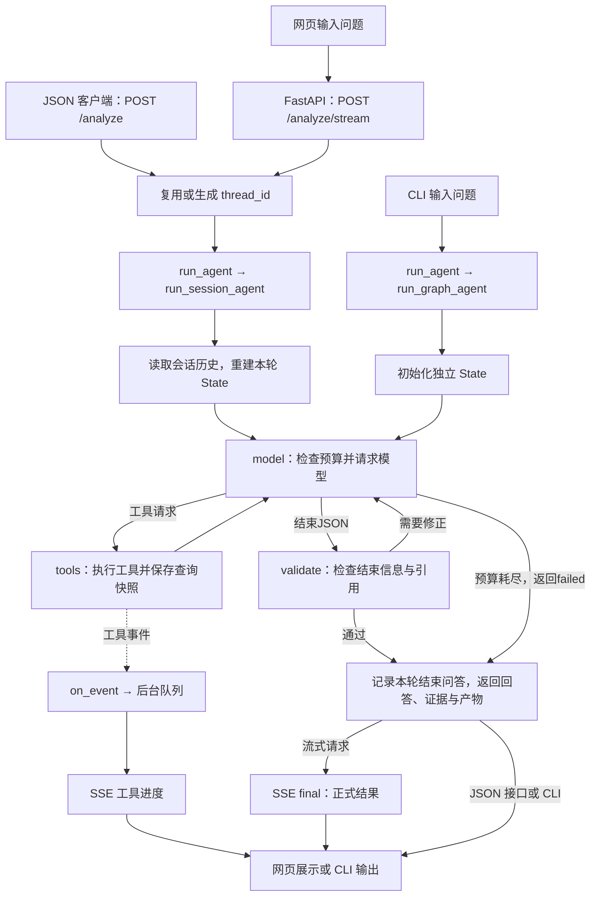

# 业务数据分析 Agent

基于 SQLite、DeepSeek Tool Calling、LangGraph 和 FastAPI 的业务数据分析项目，使用模拟电商数据。
用户用自然语言提出问题，模型选择工具和参数，Python 执行受控查询或绘图，再将结果回传模型生成回答。
网页支持连续追问、缺失条件澄清，通过 SSE 逐条接收工具进度，并在任务结束后展示正式回答和柱状图。

## 版本与验证范围

- 第一版基线：`dbf2804`。下方归档的十题评测结果与耗时对应这一版本。
- 第二版开发中：已加入 Pydantic 统一工具参数校验和任务内查询结果存储。模型向绘图工具传入 query_id，执行层取回对应数据，绘图函数直接使用该结果。
- 已加入任务结束状态与证据检查：区分 completed、needs_clarification、failed；对需要查询的完成结果，检查引用编号是否存在、结果是否被截断。
- 执行流程已迁移为 LangGraph 的 model、tools、validate 三个节点，支持条件路由、任务内查询快照传递与模型调用次数限制。
- LangGraph 迁移已通过离线回归检查和一次真实模型类别销售额绘图验收。
- 网页与 API 已接入 thread_id 和 SQLite checkpointer，支持同编号连续追问、服务重启后恢复历史、新会话隔离，以及澄清后补充条件继续完成任务。
- 会话能力已通过离线检查和真实模型功能验收，详见下方验证记录。
- 已接入可选事件回调、后台任务队列和 POST SSE 接口。网页读取分块事件并更新工具记录，正式回答在结束校验通过后发送。
- SSE 已通过事件、接口及网页离线检查，并完成真实网页验收：工具记录先出现，正式回答随后展示，金额、图片与证据引用一致。
- 第二版完整业务题集评测将在后续进行。

## 执行链路



- `get_schema`：读取三张业务表的真实建表语句。
- `run_sql`：执行以 SELECT 开头的单条查询，返回列名、数据和截断标记。
- `draw_chart`：根据两列查询结果生成柱状图。

会话模式使用 `SqliteSaver` 将图状态保存到 `sessions.db`。每个新问题只继承已结束问答，轮数、工具记录、查询缓存、图表和最终结果按本轮重新初始化。

工具使用 SQLite 只读连接、表和函数白名单。查询结果最多预览 100 行，并通过 SQLite 执行进度回调检查约 2 秒的查询预算。
每次任务最多进行 6 轮模型请求；可修复的工具错误会反馈给模型尝试修正。
查询预算是定期检查机制，轮数限制针对模型请求。

## 数据与统计口径

三张表为 `orders`（订单）、`products`（商品）、`order_items`（订单明细）。
一笔订单可以有多条明细，商品通过商品 ID 被不同订单引用。

固定模拟数据包含 6 笔订单、3 种商品、9 条明细，其中已支付 4 笔、已取消 2 笔。

- 单价使用整数分：`unit_price_cents`。
- 本项目已支付销售额按 `status = 'paid'` 的明细汇总 `quantity × unit_price_cents`，展示时除以 100 转为元。
- 取消订单的明细金额单独统计。
- 平均每单销售额使用订单数作为分母，关联明细后需要避免重复计数。
- 环比增长以对比月份为基期，例如本数据中 10 月相对 9 月为 `(1700 - 1400) / 1400 × 100% = 21.43%`。

## 主要文件

| 文件 | 职责 |
| --- | --- |
| [init_db.py](init_db.py)、[seed_data.py](seed_data.py) | 创建业务数据库并插入模拟数据 |
| [tools.py](tools.py) | 数据结构、只读 SQL 和绘图工具 |
| [agent.py](agent.py) | 模型请求、工具分发、图执行入口与 CLI |
| [graph_agent.py](graph_agent.py) | LangGraph 节点、条件路由与调用次数限制 |
| [agent_state.py](agent_state.py) | 任务状态、历史问答初始化与本轮结束记录 |
| [session_runner.py](session_runner.py) | 按会话编号恢复历史、SQLite 持久化与同会话请求冲突保护 |
| [event_models.py](event_models.py)、[stream_runner.py](stream_runner.py) | 进度事件外层格式、后台运行与队列生命周期 |
| [query_store.py](query_store.py) | 查询结果快照的存取与恢复 |
| [main.py](main.py)、[index.html](index.html) | HTTP 接口与网页 |
| [eval_fixture_v1.json](eval_fixture_v1.json)、[eval_cases_v1.json](eval_cases_v1.json) | 固定数据快照、10 个任务和标准结果 |
| [eval_data.py](eval_data.py)、[eval_agent.py](eval_agent.py) | 校验快照、恢复独立评测库、采集结果 |
| [summarize_eval.py](summarize_eval.py) | 合并审核结论并生成汇总 |
| [requirements.txt](requirements.txt)、[requirements-dev.txt](requirements-dev.txt)、[.env.example](.env.example) | 运行依赖、开发检查依赖与配置模板 |

## 本地启动

已验收环境：Windows、Python 3.12.0、SQLite 3.42.0。
绘图使用 Microsoft YaHei 中文字体。第三方库版本见 `requirements.txt`。

在项目根目录使用 PowerShell。虚拟环境通过 Python 内置的 [venv](https://docs.python.org/3.12/library/venv.html) 创建：

```powershell
if (-not (Test-Path -LiteralPath .\venv\Scripts\python.exe)) {
    python -m venv venv
}
.\venv\Scripts\python.exe -m pip install -r .\requirements.txt

if (-not (Test-Path -LiteralPath .\.env)) {
    Copy-Item -LiteralPath .\.env.example -Destination .\.env
}
```

打开 `.env`，将占位文本替换为自己的 DeepSeek API Key：

```dotenv
DEEPSEEK_API_KEY=your_api_key_here
```

模型名由 `agent.py` 中的 `MODEL_NAME` 配置，当前为 `deepseek-flash`。
配置模板可提交到仓库，真实 `.env` 由 `.gitignore` 排除。

创建并填充业务数据库：

```powershell
.\venv\Scripts\python.exe -X utf8 init_db.py
.\venv\Scripts\python.exe -X utf8 seed_data.py
```

种子脚本按主键跳过已有记录；新的空数据库运行后得到上述模拟数据。

通过 [Uvicorn](https://fastapi.tiangolo.com/deployment/manually/) 启动本地开发服务：

```powershell
.\venv\Scripts\python.exe -m uvicorn main:app --host 127.0.0.1 --port 8001 --reload
```

- 网页：[http://127.0.0.1:8001/](http://127.0.0.1:8001/)
- 接口调试：[http://127.0.0.1:8001/docs](http://127.0.0.1:8001/docs)

也可以使用 CLI：

```powershell
.\venv\Scripts\python.exe -X utf8 agent.py
```

CLI 当前执行单次独立任务；网页与 API 通过 `thread_id` 支持连续会话。

示例问题：

- 已支付订单共有多少笔？
- 2026 年 10 月的已支付销售额相比 9 月增长了百分之多少？
- 按商品类别统计已支付销售额，降序排列并绘制柱状图。

## 演示效果

示例问题：按商品类别统计已支付订单的销售额，按销售额降序排列，并绘制柱状图。

下图来自 2026-11-14 的固定任务评测：电脑配件销售额为 1800 元，显示设备为 1300 元。


## 接口

`POST /analyze` 接收 JSON，`question` 必填，`thread_id` 可选。
下例用自定义编号开始一个会话：

```json
{"question": "2026年9月的已支付销售额是多少元？", "thread_id": "demo-A"}
```

继续追问时沿用同一编号：

```json
{"question": "那10月份呢？", "thread_id": "demo-A"}
```

不传 `thread_id` 或传 `null` 时，API 会生成新编号；响应返回本次实际使用的 `thread_id`，后续追问需要传回该编号。
编号去除首尾空格后须为 1—128 个字符。请求拒绝错误类型及多余字段。

响应包含 `thread_id`（会话编号）、`status`（任务状态）、`answer`（回答）、`evidence_query_ids`（引用查询编号）、`steps`（工具调用及反馈）、`charts`（图表）。
`completed` 表示结束信息与引用检查通过，业务答案仍需核验；`needs_clarification` 表示需要补充条件；`failed` 表示本轮未能完成。
HTTP 200 与业务完成状态分别判断。

对于 `/analyze`，同一服务进程中同编号的重叠请求返回 HTTP 409；模型请求超时返回 504，模型服务请求失败返回 502。
HTTP 接口将图表路径转换成图片 URL，CLI 和评测记录保存磁盘路径。
图片由 `GET /outputs/文件名.png` 读取已有文件。

### 流式接口

`POST /analyze/stream` 使用相同的 JSON 请求字段，响应类型为 `text/event-stream`。
当前网页通过 `fetch` 发送 POST，并持续读取响应体；`/analyze` 继续保留完整 JSON 返回方式。

| 事件 | 内容与含义 |
| --- | --- |
| `tool_start` | 工具开始执行，包含轮数、工具调用编号、工具名与原始参数 |
| `tool_result` | 工具执行结果，包含对应步骤和 `result`；`ok=false` 时模型仍可修正后继续 |
| `final` | 整次调用取得正式结果，包含原接口结果字段和图表 URL；任务状态可以是完成、澄清或失败 |
| `error` | 本次执行无法继续，包含会话编号、错误类型、说明及对应的 `status_code` |

进度由 Python 在工具实际执行前后产生。未经结束校验的模型文案不会作为 `final` 发送。
事件回调与发送队列是运行时对象，不放入 State 或 SQLite 检查点。

请求字段错误在推送开始前返回 HTTP 400／422；推送开始后 HTTP 响应已经发出，执行异常改用 `error` 事件传递。
例如，同会话冲突、模型超时分别在 `error.data.status_code` 中表示为 409、504，不能只看 HTTP 200 判断任务是否成功。

后台队列有长度上限，客户端断开后停止积压发送事件。正在执行的模型请求不会被强行终止，原任务会自行收尾；同会话占用在实际任务结束后释放。
网页收到正式终止事件后停止读取；连接提前结束而没有 `final` 时显示故障，保留已收进度和输入，不自动重发任务。
本地问答历史的恢复使用 `thread_id`；当前未实现 SSE 的事件重放或 `Last-Event-ID` 断点续传。

## 会话行为

- 网页自动保存并传递会话编号，“新会话”生成新编号。
- 浏览器 `sessionStorage` 只保存编号；同一标签页刷新后可继续当前会话。页面暂时只显示本次打开后的问答，没有历史会话列表。
- 后端通过同一 `thread_id` 读取 SQLite 中的历史。服务重启后，使用原编号可以继续会话；换编号会读取另一个会话。
- 记录已结束的用户问题与最终回答，包括澄清和失败说明；临时无效回答与纠错反馈不作为后续问答历史。
- 历史用于理解省略与指代；统计值在本轮重新查询，上一轮的 `query_id` 不能直接用于本轮取数、绘图或结束引用。
- 缺少指代范围时提示模型先澄清；用户补充月份后，结合本会话原请求继续分析。该规则通过模型指令引导，结束校验仍负责格式、编号归属与截断检查，业务语义需要核验。
- 同会话请求冲突保护限于单个服务进程，尚未实现多 worker 间的请求协调。

`sessions.db` 与其伴随文件由 `.gitignore` 排除。评测和默认 CLI 调用不传 `thread_id`，每题保持独立任务，不读取业务会话历史。

## 会话功能验证

下面命令用于在新环境复现离线检查。检查使用预设模型响应，持久化检查使用临时数据库，不调用真实模型：

```powershell
.\venv\Scripts\python.exe -m pip install -r .\requirements-dev.txt
.\venv\Scripts\python.exe -X utf8 check_turn_history.py
.\venv\Scripts\python.exe -X utf8 check_session_memory.py
.\venv\Scripts\python.exe -X utf8 check_session_api.py
node .\check_session_page.cjs
```

最后一项需要 Node.js，使用内置模块执行网页脚本的逻辑检查；运行 Python 后端不需要 Node.js。
离线检查覆盖历史传递、两个独立进程恢复同会话、不同编号隔离、异常后的历史保留、同编号请求冲突、无编号独立调用，以及网页编号与状态显示。
网页逻辑检查使用模拟 DOM 和分块字节流，不代替真实浏览器验收。

2026-11-17，已在真实网页和模型上完成以下功能验收：

| 场景 | 本次观察结果 |
| --- | --- |
| 连续追问 | 先问九月已支付销售额，再问“那十月份呢”；分别重新查询得到 1400 元、1700 元 |
| 服务重启恢复 | 使用原会话编号，恢复九月、十月历史；本轮限定这两个月重新查询，合计 3100 元 |
| 新会话隔离与澄清 | 新编号没有旧月份信息，返回 needs_clarification，没有查询销售额或猜测月份 |
| 补充条件继续完成 | 同一会话补充“2026年9月和10月。”后，恢复原统计要求并重新查询，返回 completed 和本轮证据编号 |

上述记录用于验证会话行为；下方十题评测结果仍对应第一版基线，第二版完整业务题集评测另行进行。

## SSE 功能验证

在已有开发依赖环境中，可用下面命令复现离线检查；它们使用预设模型与工具，不调用真实模型 API：

```powershell
.\venv\Scripts\python.exe -X utf8 check_agent_events.py
.\venv\Scripts\python.exe -X utf8 check_agent_completion.py
.\venv\Scripts\python.exe -X utf8 check_sse_api.py
.\venv\Scripts\python.exe -X utf8 check_session_api.py
node .\check_session_page.cjs
```

检查覆盖事件与真实工具调用的先后顺序、失败后继续修复、事件数据隔离、旧接口兼容、任务尚未结束时收到进度、有界队列与客户端断线清理、同会话占用、终止事件、SSE 响应头及帧格式，以及网页中文分块解析与异常处理。
队列和断线场景使用临时数据库、假模型或 ASGI 消息模拟；所有测试线程在结束时收尾。

2026-11-17，真实网页请求“按商品类别统计已支付订单的销售额，按销售额降序排列，并绘制柱状图。”的核验记录：

| 检查项 | 本次结果 |
| --- | --- |
| 统计结果 | 电脑配件 1800 元、显示设备 1300 元，均来自本轮已支付订单查询 |
| 查询与绘图关联 | 绘图参数、工具反馈与最终引用使用同一 `query_id` |
| 图片 | 两柱降序、中文和金额正常，用户确认网页显示正常 |
| 结束校验 | 第 4 轮夹带文案的结束信息被拒绝，第 5 轮修正后才正式返回；历史仅保存通过后的回答 |
| 回答前的进度显示 | 用户确认先看到工具记录，随后才出现正式回答 |

本次为功能验收记录，不替代第二版完整业务题集评测。

## 固定任务评测

评测读取仓库中的 `eval_fixture_v1.json`，恢复独立数据库，避免业务库后续新增订单改变评测数据。
报告记录数据、题集以及 `agent.py`、`tools.py` 的代码指纹。
评测脚本仅将每题的 `question` 字段传给 Agent，标准结果 `expected` 留在本地核对。
`freeze_eval_data.py` 用于制作数据快照，当前 v1 快照已提供。

先执行离线检查：

```powershell
.\venv\Scripts\python.exe -X utf8 eval_data.py
```

单题试跑可使用 `--case E01`；完整采集使用：

```powershell
.\venv\Scripts\python.exe -X utf8 eval_agent.py --case all
```

该步骤会调用模型服务。每批结果保存在新建的 `eval_runs/run_*/` 目录，包括数据库、原始报告、逐题日志和生成的图片。

### 审核与汇总新批次

1. 对照每题的 `expected`，核对成功 SQL 结果、最终回答、统计口径和要求的图片。
2. 在该批次目录创建 `review.json`，格式可参考[已归档审核记录](eval_runs/run_0d6a458fdeda/review.json)。
3. 为该批次每个题目填写真实的 `passed` 布尔值与非空 `notes`；`execution_status=completed` 表示调用正常返回，`result.status` 是 Agent 的任务状态，是否答对仍需核验。
4. `source_report_sha256` 应填写本次原始报告的内容指纹，不能直接沿用其他批次的指纹。

将下方变量替换成终端打印的本次真实报告路径，再计算指纹：

```powershell
$reportPath = ".\eval_runs\run_替换为本次目录\report.json"
.\venv\Scripts\python.exe -X utf8 -c "import json,sys; from pathlib import Path; from eval_data import content_hash; print(content_hash(json.loads(Path(sys.argv[1]).read_text(encoding='utf-8'))))" $reportPath
```

审核文件完整后生成汇总：

```powershell
.\venv\Scripts\python.exe -X utf8 summarize_eval.py --report $reportPath
```

生成 `report_reviewed.json` 与 `summary.md`。汇总按审核结论统计通过数，原始运行报告保留。

### 已归档验收结果

2026-11-14，在上述固定模拟数据的 10 项任务上完成一次采集，并复查 SQL、回答和图片：

| 指标 | 本次结果 |
| --- | --- |
| 固定任务核验通过 | 10/10 |
| 平均单题任务耗时 | 4.793 秒 |
| 任务耗时中位数 | 4.131 秒 |
| 最长单题任务耗时 | 8.197 秒 |

[评测汇总](eval_runs/run_0d6a458fdeda/summary.md) · [原始报告](eval_runs/run_0d6a458fdeda/report.json) · [合并审核报告](eval_runs/run_0d6a458fdeda/report_reviewed.json)

E05 中，WITH 开头的查询被工具规则拒绝后，模型根据反馈改写为 SELECT，并在 6 轮预算内完成环比计算。
中间错误保留在[E05 日志](eval_runs/run_0d6a458fdeda/E05.log)中。
上述通过数按固定任务核验结论统计，耗时为该批次 Agent 任务耗时。
