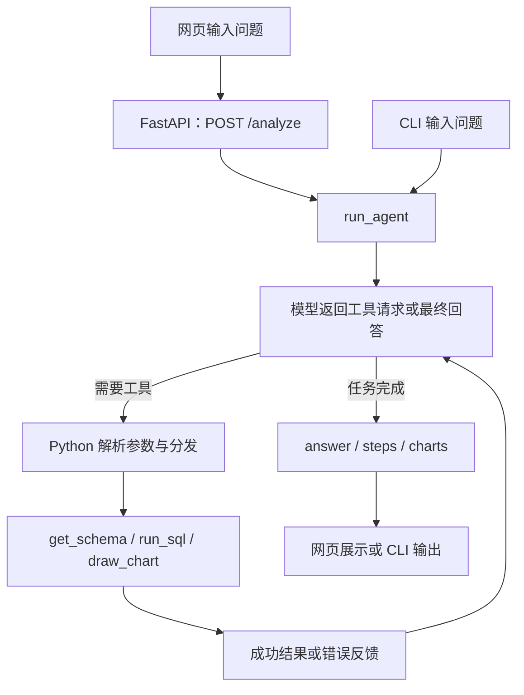

# 业务数据分析 Agent

基于 SQLite、DeepSeek Tool Calling 和 FastAPI 的业务数据分析项目，使用模拟电商数据。
用户用自然语言提出问题，模型选择工具和参数，Python 执行受控查询或绘图，再将结果回传模型生成回答。
网页可展示回答、工具调用记录和柱状图。

## 版本与验证范围

- 第一版基线：`dbf2804`。下方归档的十题评测结果与耗时对应这一版本。
- 第二版开发中：已加入 Pydantic 统一工具参数校验和任务内查询结果存储。模型向绘图工具传入 query_id，执行层取回对应数据，绘图函数直接使用该结果。
- 新增能力已通过离线检查和真实模型的类别销售额绘图验收；第二版完整业务题集评测将在后续进行。

## 执行链路



- `get_schema`：读取三张业务表的真实建表语句。
- `run_sql`：执行以 SELECT 开头的单条查询，返回列名、数据和截断标记。
- `draw_chart`：根据两列查询结果生成柱状图。

工具使用 SQLite 只读连接、表和函数白名单。查询结果最多预览 100 行，并通过 SQLite 执行进度回调检查约 2 秒的查询预算。
每次任务最多进行 6 轮模型请求；可修复的工具错误会反馈给模型尝试修正。
查询预算是定期检查机制，轮数限制针对模型请求。

## 数据与统计口径

三张表为 `orders`（订单）、`products`（商品）、`order_items`（订单明细）。
一笔订单可以有多条明细，商品通过商品 ID 被不同订单引用。

固定模拟数据包含 6 笔订单、3 种商品、9 条明细，其中已支付 4 笔、已取消 2 笔。

- 单价使用整数分：`unit_price_cents`。
- 本项目已支付销售额按 `status = 'paid'` 的明细汇总 `quantity × unit_price_cents`，展示时除以 100 转为元。
- 取消订单的明细金额单独统计。
- 平均每单销售额使用订单数作为分母，关联明细后需要避免重复计数。
- 环比增长以对比月份为基期，例如本数据中 10 月相对 9 月为 `(1700 - 1400) / 1400 × 100% = 21.43%`。

## 主要文件

| 文件 | 职责 |
| --- | --- |
| [init_db.py](init_db.py)、[seed_data.py](seed_data.py) | 创建业务数据库并插入模拟数据 |
| [tools.py](tools.py) | 数据结构、只读 SQL 和绘图工具 |
| [agent.py](agent.py) | 模型请求、工具分发、多轮反馈与 CLI |
| [main.py](main.py)、[index.html](index.html) | HTTP 接口与网页 |
| [eval_fixture_v1.json](eval_fixture_v1.json)、[eval_cases_v1.json](eval_cases_v1.json) | 固定数据快照、10 个任务和标准结果 |
| [eval_data.py](eval_data.py)、[eval_agent.py](eval_agent.py) | 校验快照、恢复独立评测库、采集结果 |
| [summarize_eval.py](summarize_eval.py) | 合并审核结论并生成汇总 |
| [requirements.txt](requirements.txt)、[.env.example](.env.example) | 直接依赖版本与配置模板 |

## 本地启动

已验收环境：Windows、Python 3.12.0、SQLite 3.42.0。
绘图使用 Microsoft YaHei 中文字体。第三方库版本见 `requirements.txt`。

在项目根目录使用 PowerShell。虚拟环境通过 Python 内置的 [venv](https://docs.python.org/3.12/library/venv.html) 创建：

```powershell
if (-not (Test-Path -LiteralPath .\venv\Scripts\python.exe)) {
    python -m venv venv
}
.\venv\Scripts\python.exe -m pip install -r .\requirements.txt

if (-not (Test-Path -LiteralPath .\.env)) {
    Copy-Item -LiteralPath .\.env.example -Destination .\.env
}
```

打开 `.env`，将占位文本替换为自己的 DeepSeek API Key：

```dotenv
DEEPSEEK_API_KEY=your_api_key_here
```

模型名由 `agent.py` 中的 `MODEL_NAME` 配置，当前为 `deepseek-flash`。
配置模板可提交到仓库，真实 `.env` 由 `.gitignore` 排除。

创建并填充业务数据库：

```powershell
.\venv\Scripts\python.exe -X utf8 init_db.py
.\venv\Scripts\python.exe -X utf8 seed_data.py
```

种子脚本按主键跳过已有记录；新的空数据库运行后得到上述模拟数据。

通过 [Uvicorn](https://fastapi.tiangolo.com/deployment/manually/) 启动本地开发服务：

```powershell
.\venv\Scripts\python.exe -m uvicorn main:app --host 127.0.0.1 --port 8001 --reload
```

- 网页：[http://127.0.0.1:8001/](http://127.0.0.1:8001/)
- 接口调试：[http://127.0.0.1:8001/docs](http://127.0.0.1:8001/docs)

也可以使用 CLI：

```powershell
.\venv\Scripts\python.exe -X utf8 agent.py
```

示例问题：

- 已支付订单共有多少笔？
- 2026 年 10 月的已支付销售额相比 9 月增长了百分之多少？
- 按商品类别统计已支付销售额，降序排列并绘制柱状图。

## 演示效果

示例问题：按商品类别统计已支付订单的销售额，按销售额降序排列，并绘制柱状图。

下图来自 2026-11-14 的固定任务评测：电脑配件销售额为 1800 元，显示设备为 1300 元。


## 接口

`POST /analyze` 接收 JSON：

```json
{"question": "已支付订单共有多少笔？"}
```

返回 `answer`（回答）、`steps`（工具调用及反馈）、`charts`（图表）。
HTTP 接口将图表路径转换成图片 URL，CLI 和评测记录保存磁盘路径。
图片由 `GET /outputs/文件名.png` 读取已有文件。

## 固定任务评测

评测读取仓库中的 `eval_fixture_v1.json`，恢复独立数据库，避免业务库后续新增订单改变评测数据。
报告记录数据、题集以及 `agent.py`、`tools.py` 的代码指纹。
评测脚本仅将每题的 `question` 字段传给 Agent，标准结果 `expected` 留在本地核对。
`freeze_eval_data.py` 用于制作数据快照，当前 v1 快照已提供。

先执行离线检查：

```powershell
.\venv\Scripts\python.exe -X utf8 eval_data.py
```

单题试跑可使用 `--case E01`；完整采集使用：

```powershell
.\venv\Scripts\python.exe -X utf8 eval_agent.py --case all
```

该步骤会调用模型服务。每批结果保存在新建的 `eval_runs/run_*/` 目录，包括数据库、原始报告、逐题日志和生成的图片。

### 审核与汇总新批次

1. 对照每题的 `expected`，核对成功 SQL 结果、最终回答、统计口径和要求的图片。
2. 在该批次目录创建 `review.json`，格式可参考[已归档审核记录](eval_runs/run_0d6a458fdeda/review.json)。
3. 为该批次每个题目填写真实的 `passed` 布尔值与非空 `notes`；`completed` 仅表示返回了最终回答。
4. `source_report_sha256` 应填写本次原始报告的内容指纹，不能直接沿用其他批次的指纹。

将下方变量替换成终端打印的本次真实报告路径，再计算指纹：

```powershell
$reportPath = ".\eval_runs\run_替换为本次目录\report.json"
.\venv\Scripts\python.exe -X utf8 -c "import json,sys; from pathlib import Path; from eval_data import content_hash; print(content_hash(json.loads(Path(sys.argv[1]).read_text(encoding='utf-8'))))" $reportPath
```

审核文件完整后生成汇总：

```powershell
.\venv\Scripts\python.exe -X utf8 summarize_eval.py --report $reportPath
```

生成 `report_reviewed.json` 与 `summary.md`。汇总按审核结论统计通过数，原始运行报告保留。

### 已归档验收结果

2026-11-14，在上述固定模拟数据的 10 项任务上完成一次采集，并复查 SQL、回答和图片：

| 指标 | 本次结果 |
| --- | --- |
| 固定任务核验通过 | 10/10 |
| 平均单题任务耗时 | 4.793 秒 |
| 任务耗时中位数 | 4.131 秒 |
| 最长单题任务耗时 | 8.197 秒 |

[评测汇总](eval_runs/run_0d6a458fdeda/summary.md) · [原始报告](eval_runs/run_0d6a458fdeda/report.json) · [合并审核报告](eval_runs/run_0d6a458fdeda/report_reviewed.json)

E05 中，WITH 开头的查询被工具规则拒绝后，模型根据反馈改写为 SELECT，并在 6 轮预算内完成环比计算。
中间错误保留在[E05 日志](eval_runs/run_0d6a458fdeda/E05.log)中。
上述通过数按固定任务核验结论统计，耗时为该批次 Agent 任务耗时。
